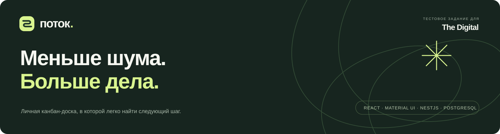
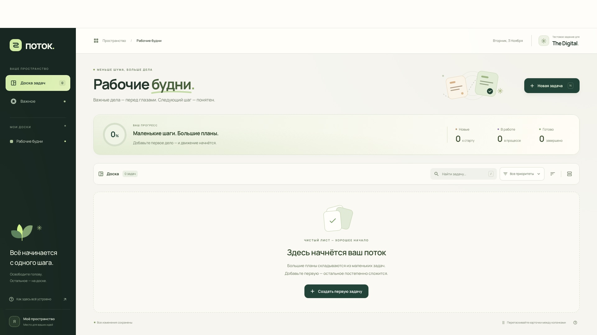
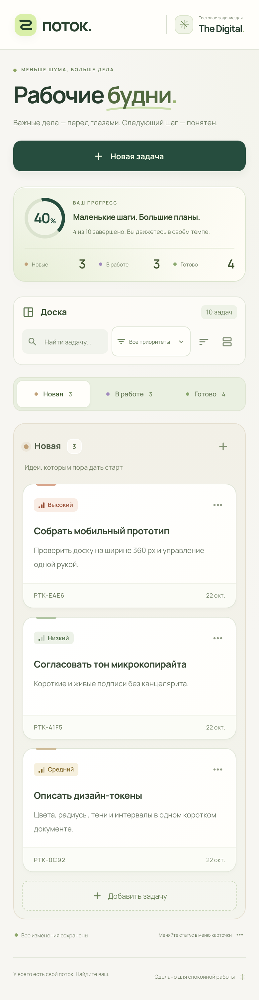

# Поток

Мини-задачник с канбан-доской, созданный как тестовое задание для **The Digital**.

<p align="center">
  <a href="https://korotkov.click"><strong>Открыть работающий сайт → korotkov.click</strong></a>
</p>

Сайт доступен без регистрации и пароля. Это общая доска: посетители видят одни и те же задачи и могут создавать, изменять, перемещать и удалять их.



## Возможности

- Три статуса: «Новая», «В работе», «Готово».
- Название, описание и приоритет задачи.
- Просмотр, редактирование и удаление с подтверждением.
- Drag and Drop на компьютере и смена статуса через меню на телефоне.
- Поиск, фильтр по приоритету, раздел «Важное» и компактный вид.
- Состояния загрузки, ошибки, пустой доски и сохранения.
- Данные хранятся в PostgreSQL и остаются после перезагрузки.
- Адаптивный интерфейс от 320 до 1920 px.

Дополнительное улучшение — поиск вместе с фильтром приоритета. Горячие клавиши: `N` / `Т` для новой задачи и `/` для поиска.

<details>
<summary>Посмотреть мобильную версию</summary>

<p align="center"></p>

</details>

## Стек

| Часть | Технологии |
| --- | --- |
| Интерфейс | TypeScript, React 19, Vite 7, Material UI 7 |
| API | TypeScript, NestJS 11, `pg` |
| Данные | PostgreSQL 17, версионированные SQL-миграции |
| Проверки | Node Test Runner, Vitest, Playwright |
| Production | Docker Compose, Caddy, HTTPS, Cloudflare |

## Локальный запуск

Понадобятся Node.js 22.12+, npm и Docker с Compose.

```bash
git clone https://github.com/ischeez/Potok.git
cd Potok
npm ci
cp .env.example .env
npm run db:up
npm run db:migrate
npm run dev
```

Откройте [localhost:5173](http://localhost:5173). Для демонстрационных задач выполните `npm run db:seed` и обновите страницу.

## Проверки

```bash
npm run check             # lint, TypeScript, unit-тесты и сборка
npm run test:integration  # API и настоящая PostgreSQL
npx playwright install chromium
npm run test:e2e          # пользовательские сценарии в Chromium
```

Проверены CRUD, валидация, перенос и сохранение задач, поиск и фильтры, ошибки API, пустая доска и адаптивность. GitHub Actions запускает проверки с отдельным PostgreSQL service.

## Решения и ограничения

Интерфейс ждёт успешный ответ API перед переносом или удалением карточки, поэтому ошибка сети не оставляет экран и базу в разных состояниях. SQL написан напрямую: для одной сущности это сохраняет схему и миграции прозрачными без лишнего слоя ORM.

Production — одна открытая общая доска без пользовательских аккаунтов. Любой посетитель может менять задачи; живой синхронизации между вкладками, истории изменений, офлайн-режима и восстановления удалённых задач пока нет.

Развёртывание использует HTTPS, закрытые внутренние порты API и PostgreSQL, ежедневные резервные копии и автоматический запуск контейнеров. Подробности: [production на VPS](docs/deployment.md), [результаты проверки](docs/delivery.md).

## AI и время

AI помог со структурой проекта, интерфейсом, API, миграциями, тестами и документацией. Код проверялся реальными unit-, интеграционными и браузерными сценариями, а не только чтением.

Первоначальная сборка и проверка заняли около 30 минут активной работы с AI. Дизайн и production-развёртывание дорабатывались позже; их суммарное время не замерялось.
